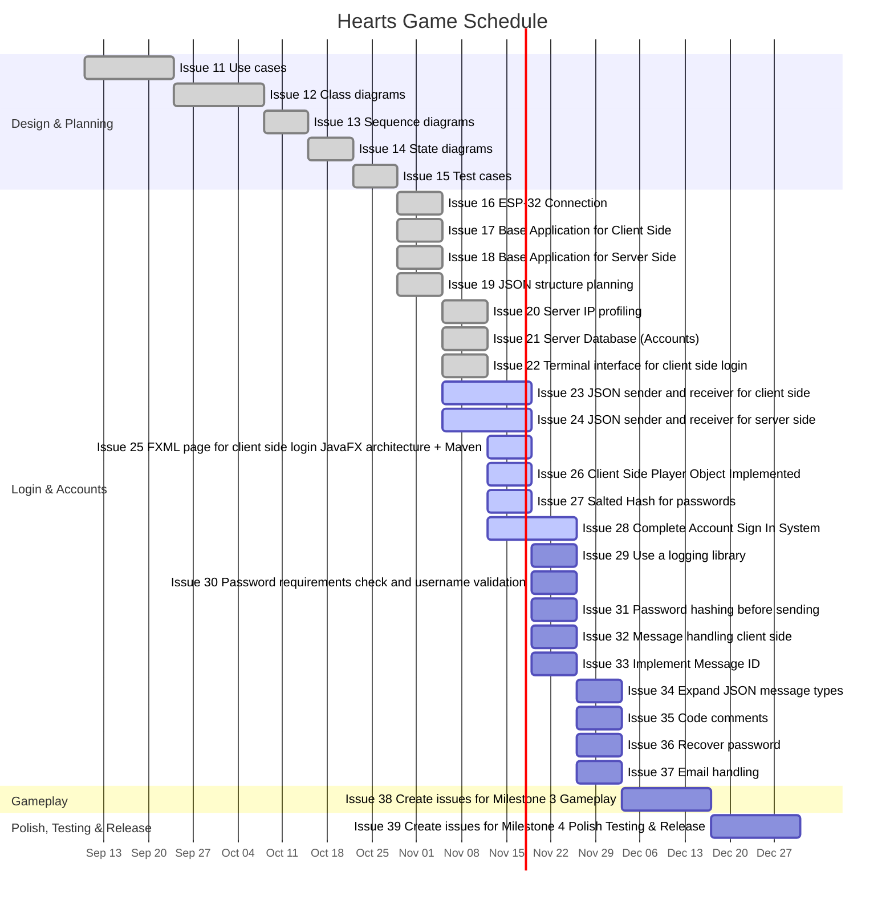

# Game of Hearts

This is a simple **Game of Hearts** project for a Software Engineering course (CSC 335).

## Project Goal
Build a basic Hearts card game implementation for learning and coursework.

## Team Members
- Khusanjon B — server side (`HeartsServer/`) & ESP-32 (`ESP32-Network/`)
- Ryan B
- Carlo D

## Project Structure
- `client/` — Java / JavaFX client (Maven)
- `HeartsServer/` — C++ server (CMake)
- `ESP32-Network/` — ESP-32 networking sketch

## Schedule

The project follows a waterfall plan. Each milestone is tracked as a [GitHub milestone](https://github.com/Khusanjon-B/CSC335-HeartsGame/milestones) with one issue per task; every issue lists its start and expected finish dates.

| Milestone | Dates | Status |
|---|---|---|
| 1. Design & Planning | Sep 10 – Oct 28, 2026 | ✅ Complete |
| 2. Login & Accounts | Oct 29 – Dec 2, 2026 | 🚧 In progress |
| 3. Gameplay (game logic, lobby/matchmaking) | Dec 3 – Dec 16, 2026 (tentative) | ⏳ Not started |
| 4. Polish, Testing & Release | Dec 17 – Dec 30, 2026 (tentative) | ⏳ Not started |

## Progress

### Milestone 1: Design & Planning — complete
Use cases, class diagrams, sequence diagrams, state diagrams, and test cases.

### Milestone 2: Login & Accounts

**Done**

| Issue | Task | Dates |
|---|---|---|
| #16 | ESP-32 Connection | 2026-10-29 → 2026-11-04 |
| #17 | Base Application for Client Side | 2026-10-29 → 2026-11-04 |
| #18 | Base Application for Server Side | 2026-10-29 → 2026-11-04 |
| #19 | JSON structure planning | 2026-10-29 → 2026-11-04 |
| #20 | Server IP profiling | 2026-11-05 → 2026-11-11 |
| #21 | Server Database (Accounts) | 2026-11-05 → 2026-11-11 |
| #22 | Terminal interface for client side login | 2026-11-05 → 2026-11-11 |

**In progress**

| Issue | Task | Dates |
|---|---|---|
| #23 | JSON sender and receiver for client side | 2026-11-05 → 2026-11-18 |
| #24 | JSON sender and receiver for server side | 2026-11-05 → 2026-11-18 |
| #25 | FXML page for client side login, JavaFX architecture + Maven | 2026-11-12 → 2026-11-18 |
| #26 | Client Side Player Object Implemented | 2026-11-12 → 2026-11-18 |
| #27 | Salted Hash for passwords | 2026-11-12 → 2026-11-18 |
| #28 | Complete Account Sign In System | 2026-11-12 → 2026-11-25 |

**To do**

| Issue | Task | Dates |
|---|---|---|
| #29 | Use a logging library | 2026-11-19 → 2026-11-25 |
| #30 | Password requirements check and username validation | 2026-11-19 → 2026-11-25 |
| #31 | Password hashing before sending | 2026-11-19 → 2026-11-25 |
| #32 | Message handling client side | 2026-11-19 → 2026-11-25 |
| #33 | Implement Message ID | 2026-11-19 → 2026-11-25 |
| #34 | Expand JSON message types | 2026-11-26 → 2026-12-02 |
| #35 | Code comments | 2026-11-26 → 2026-12-02 |
| #36 | Recover password | 2026-11-26 → 2026-12-02 |
| #37 | Email handling | 2026-11-26 → 2026-12-02 |

## Notes
- Course project
- Work in progress
- Check wiki to learn how to use git
- Not production-ready
- Ryan's note
- another note from Ryan, but from my desktop
